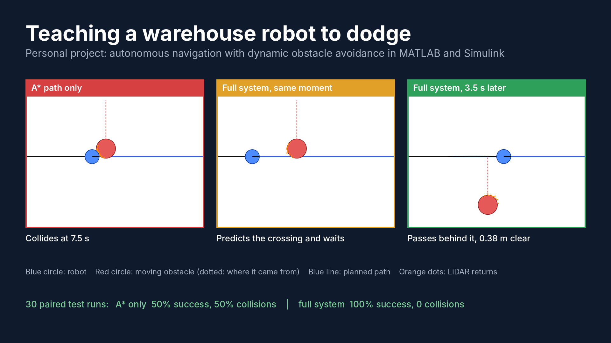
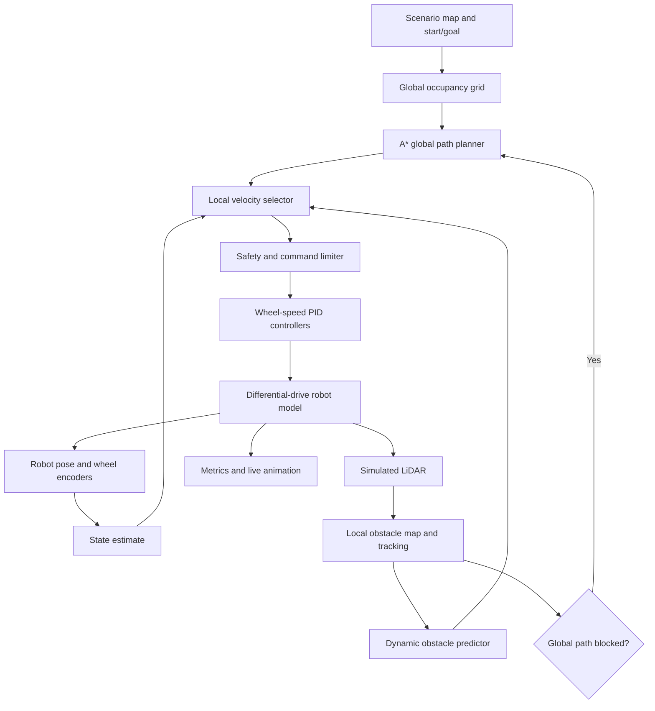

# Autonomous Robot Navigation with Dynamic Obstacle Avoidance

**MATLAB / Simulink | Mechatronics and Robotics Engineering | Simulation-first project**



A simulated warehouse robot that spots moving obstacles with LiDAR, predicts where they are going, checks every move 2.5 s ahead and replans when an aisle gets blocked. Built in MATLAB and Simulink.

| Same 30 seeded scenarios | Reached goal | Collisions |
|---|---|---|
| A* path only | 15 / 30 | 15 |
| A* + emergency stop | 16 / 30 | 8 (plus 6 stuck) |
| **Full system** | **30 / 30** | **0** |

Demo videos: [`results/videos`](results/videos) · Quick start and full results: [section 24](#24-quick-start-and-results)

```matlab
cd('amr-navigation-matlab')
addpath('src/utils'); setupPaths();
run('src/main.m')      % animated demo
runAll                 % tests, benchmark, figures, Simulink comparison
```

> **Implementation status:** complete and verified on MATLAB R2025b (Update 4), macOS arm64.
> Core MATLAB only, no toolbox needed for the simulation; Simulink is needed only for `simulink/`.
> See section 24 for quick start and results.

## 1. Project overview

Design, simulate, test, and evaluate a differential-drive autonomous mobile robot (AMR) that travels from a defined start pose to a goal while avoiding stationary and moving obstacles. The robot uses a global A* planner, a local dynamic-obstacle avoidance layer, simulated range sensing, and closed-loop wheel-speed control. The system must replan when the current path is blocked and report measurable performance.

**Core research question:** How much does local dynamic-obstacle avoidance combined with global replanning improve collision-free navigation compared with a global-only A* baseline?

**Scope:** 2D indoor warehouse-like environments, no physical robot required. Do not claim real-world safety from simulation alone.

## 2. Success criteria

Use these as **proposed engineering targets**, not guaranteed results:

| Metric | Proposed acceptance target | Measurement |
|---|---|---|
| Goal attainment | >= 90% over at least 30 seeded scenarios | Final robot position within 0.25 m of goal |
| Collisions | 0 in nominal test suite | Robot footprint intersects an obstacle |
| Minimum clearance | >= 0.15 m beyond robot footprint where feasible | Minimum obstacle-to-footprint distance |
| Replanning response | <= 1 s simulated time after a detected blockage | Detection-to-new-valid-path latency |
| Tracking error | Mean cross-track error <= 0.20 m on static maps | Distance to reference path |
| Completion time | Report mean, median, and worst case | Simulation clock at goal |
| Repeatability | Same seed produces same outputs | Deterministic random seeds |

Define **failure** explicitly: collision, timeout, invalid path, unreachable goal, or persistent oscillation. A controller should stop safely when it cannot find a feasible motion.

## 3. Required software

- MATLAB, preferably a recent release (document your exact version).
- Recommended: Navigation Toolbox for occupancy grids, planners, and range-sensor workflows; Robotics System Toolbox for robotics utilities; Simulink for block-diagram modelling; Control System Toolbox for control analysis.
- Optional: Automated Driving Toolbox or Sensor Fusion and Tracking Toolbox for more advanced tracking, and Parallel Computing Toolbox for batch tests.
- The baseline can be written in core MATLAB using arrays, graphs, and custom functions. **Toolbox APIs vary by release**: verify functions with `ver`, `help`, and the installed documentation before implementation.

Check installation:

```matlab
ver
which occupancyMap
which lidarScan
which sim
```

A missing optional toolbox should not block the core MATLAB-only prototype.

## 4. Repository layout

```text
amr-navigation-matlab/
├── README.md
├── LICENSE
├── .gitignore
├── config/
│   └── defaultConfig.m
├── maps/
│   ├── warehouse01.mat
│   └── scenarioDefinitions.m
├── src/
│   ├── main.m
│   ├── mapping/createMap.m
│   ├── planning/astarGrid.m
│   ├── planning/inflateObstacles.m
│   ├── planning/isPathBlocked.m
│   ├── planning/smoothPath.m
│   ├── control/computeTrackingCommand.m
│   ├── control/wheelPID.m
│   ├── control/limitCommand.m
│   ├── dynamics/differentialDriveStep.m
│   ├── sensing/simulateRangeScan.m
│   ├── sensing/updateLocalMap.m
│   ├── tracking/estimateObstacleMotion.m
│   ├── avoidance/selectSafeVelocity.m
│   ├── collision/checkFootprintCollision.m
│   ├── visualization/animateScenario.m
│   └── metrics/computeMetrics.m
├── simulink/
│   └── amrNavigation.slx
├── tests/
│   ├── testAStar.m
│   ├── testKinematics.m
│   ├── testCollision.m
│   ├── testAvoidance.m
│   └── runScenarios.m
├── scripts/
│   ├── runBaseline.m
│   ├── runFullSystem.m
│   ├── runBenchmark.m
│   └── plotResults.m
├── results/
│   ├── figures/
│   ├── logs/
│   └── tables/
└── docs/
    ├── architecture.md
    ├── mathematicalModel.md
    ├── testPlan.md
    └── finalReportOutline.md
```

**Implemented.** Additional files beyond the original layout: `runAll.m` (one-command reproduction), `src/core/` (simulation stages shared by MATLAB and Simulink), `src/utils/`, `scripts/generateMaps.m`, `scripts/compareSimulink.m`, `simulink/buildSimulinkModel.m` (generates `amrNavigation.slx`), `simulink/amrSimBridge.m`, `simulink/runSimulinkModel.m`, `tests/runAllTests.m`, `tests/testMapping.m`, `tests/testReplanning.m`, `tests/testDeterminism.m`.

## 5. System architecture



Separate **ground truth** (simulation state) from **estimated perception** (sensor measurements). The navigation controller must not read hidden obstacle positions directly except in a clearly labelled oracle baseline.

## 6. Coordinate frames and robot parameters

Use SI units throughout. World frame: x right, y up, yaw positive counterclockwise. Robot body frame: x forward, y left. Grid indices are `(row, column)` and must be converted consistently to `(x, y)` metres.

Suggested initial configuration:

```matlab
function cfg = defaultConfig()
    cfg.dt = 0.05;                  % s, simulation/control step
    cfg.duration = 120;             % s, maximum scenario duration
    cfg.seed = 42;
    cfg.map.width = 20;             % m
    cfg.map.height = 15;            % m
    cfg.map.resolution = 10;        % cells per metre
    cfg.robot.radius = 0.22;        % m, circular footprint approximation
    cfg.robot.wheelRadius = 0.05;   % m
    cfg.robot.wheelBase = 0.32;     % m, centre-to-centre
    cfg.robot.vMax = 0.65;         % m/s
    cfg.robot.wMax = 1.4;          % rad/s
    cfg.robot.aMax = 0.6;          % m/s^2
    cfg.robot.alphaMax = 2.0;      % rad/s^2
    cfg.safety.margin = 0.15;      % m, additional clearance
    cfg.safety.ttcStop = 0.7;      % s, conservative stop threshold
    cfg.sensor.maxRange = 6.0;     % m
    cfg.sensor.fov = 270;          % degrees
    cfg.sensor.numBeams = 181;
    cfg.sensor.rangeNoiseStd = 0.02; % m
    cfg.planner.replanPeriod = 0.5;  % s
    cfg.goal.tolerance = 0.25;    % m
end
```

Treat parameters as tunable starting values. Record final calibrated values and reasons for changes.

## 7. Mathematical model

### 7.1 Differential-drive kinematics

For right and left wheel angular speeds `omega_R` and `omega_L`, wheel radius `r`, and wheel separation `b`:

\[
 v=\frac{r}{2}(\omega_R+\omega_L),\qquad
 \omega=\frac{r}{b}(\omega_R-\omega_L).
\]

Robot pose `q=[x,y,theta]^T` evolves as:

\[
 \dot{x}=v\cos\theta,\quad
 \dot{y}=v\sin\theta,\quad
 \dot{\theta}=\omega.
\]

Use forward Euler initially; compare with midpoint integration as a numerical verification exercise. Normalize yaw to `[-pi, pi)`.

### 7.2 A* path planning

Create a binary occupancy grid (`0=free`, `1=occupied`), inflate occupied cells by `robot.radius + safety.margin`, then search an 8-connected graph. Edge costs are 1 cell for axial moves and `sqrt(2)` cells for diagonals, scaled by cell size. Use an admissible **octile-distance** heuristic. Prevent diagonal corner cutting: a diagonal transition is illegal if either adjacent axial cell is occupied.

A* evaluation:

\[
 f(n)=g(n)+h(n).
\]

Return path waypoints in world metres, total length, expanded-node count, and success/failure status. Validate start and goal against inflated obstacles.

### 7.3 Heading and velocity control

For the next look-ahead waypoint `(x_t,y_t)`:

\[
 e_\theta=\operatorname{wrapToPi}(\operatorname{atan2}(y_t-y,x_t-x)-\theta).
\]

Start with `omega_cmd = Kp_heading*e_theta` and `v_cmd = vMax*max(0,cos(e_theta))`, subject to acceleration and speed limits. Add derivative/integral action only if tests show a benefit; avoid integral windup. Implement separate wheel-speed PID loops if modelling motor dynamics.

### 7.4 Dynamic obstacle avoidance

Use a **dynamic window approach (DWA)-style** local velocity sampler:

1. Generate candidate `(v,omega)` commands reachable within acceleration limits.
2. Predict the robot trajectory for a 2–3 s horizon at each candidate.
3. Predict moving-obstacle positions with a documented constant-velocity model and uncertainty buffer.
4. Reject any candidate whose robot footprint violates clearance at any predicted step.
5. Score remaining candidates by progress toward the local waypoint, path deviation, clearance, smoothness, and stopping ability.
6. Select the lowest-cost safe command; if none is safe, command a controlled stop.

Illustrative objective (normalize all terms before combining):

\[
 J=w_g d_{goal}+w_p d_{path}+w_c\,\mathrm{clearancePenalty}
 +w_u\|u-u_{prev}\|^2.
\]

Do **not** use an attractive goal-only controller as the collision safety mechanism. Check the full predicted swept path and account for braking distance and obstacle motion. DWA is a local planner, not a guarantee of collision avoidance under imperfect sensing.

## 8. Mapping and sensing

- Begin with a **known static map** for global planning and a separate local map for newly detected obstacles.
- Generate simulated LiDAR beams using ray casting against obstacles. Add configurable Gaussian range noise, limited field of view, maximum range, and occasional missed returns.
- Estimate robot pose initially from exact simulation pose for the control-baseline phase; then introduce noisy odometry to assess robustness.
- Associate obstacle detections across time and estimate velocity from filtered position differences. For a first version, use well-separated circular moving obstacles and nearest-neighbour association with gating.
- Maintain timestamps; expire stale detections. Unknown space should not silently be treated as proven free.
- Trigger replanning if the global path becomes obstructed, the robot deviates significantly, or the periodic replan interval expires.

**Replanning rule:** Do not repeatedly replan on every sensor beam. Use a debounce/hysteresis interval, validate the new path, and retain the previous safe plan until a replacement is available. Stop if the old path is unsafe and no new route exists.

## 9. Build sequence

### Phase 1 — Static world and robot (Days 1–3)

- [ ] Create a 20 m × 15 m warehouse map with walls, shelves, corridors, and start/goal markers.
- [ ] Implement differential-drive kinematics and pose animation.
- [ ] Add speed and acceleration saturation.
- [ ] Verify straight travel, in-place rotation, and circular motion against analytical expectations.

**Exit condition:** Robot motion is numerically correct and visually reproducible.

### Phase 2 — Global A* navigation (Days 4–7)

- [ ] Inflate obstacles to account for robot radius and safety margin.
- [ ] Implement A* with corner-cut prevention and clear failure statuses.
- [ ] Convert grid cells into world-coordinate waypoints.
- [ ] Implement look-ahead tracking and heading control.
- [ ] Reach the goal in at least three static scenarios without collision.

**Exit condition:** Reliable static navigation with logged tracking error.

### Phase 3 — Sensor simulation (Days 8–10)

- [ ] Add LiDAR ray casting and range noise.
- [ ] Build a local occupancy representation from sensor returns.
- [ ] Visualize measured points separately from ground-truth obstacles.
- [ ] Test sensor dropouts, blind spots, and false returns.

**Exit condition:** Local perception updates correctly and its limitations are visible.

### Phase 4 — Moving obstacles and avoidance (Days 11–15)

- [ ] Create scripted pedestrian/forklift-like moving obstacles (abstract moving shapes only).
- [ ] Implement obstacle detection association and velocity estimation.
- [ ] Add sampled local velocity search and future collision checks.
- [ ] Implement emergency stop when no candidate is feasible.
- [ ] Add path-blockage detection and global replanning.

**Exit condition:** Robot avoids moving obstacles in a set of controlled scenarios, with failures logged.

### Phase 5 — Simulink integration (Days 16–19)

- [ ] Implement plant, sensors, controllers, planner and supervisor as separate subsystems.
- [ ] Use fixed-step discrete simulation with `dt=0.05 s` initially.
- [ ] Pass signals through clearly defined interfaces (pose, scan, path, command, status).
- [ ] Log states and commands with consistent time bases.
- [ ] Compare a Simulink run against the MATLAB-script implementation for the same seed and configuration.

**Exit condition:** Simulink model reproduces the reference simulation within documented numerical tolerances.

### Phase 6 — Evaluation and report (Days 20–24)

- [ ] Run all baseline and full-system scenarios across at least 30 fixed random seeds.
- [ ] Export trajectories, event logs, metrics and figures.
- [ ] Compare A* only vs A* + reactive stop vs A* + local avoidance + replanning.
- [ ] Vary obstacle speed, sensor noise, corridor width, and robot speed.
- [ ] Explain failures, trade-offs, computational load and limitations.

**Exit condition:** Results can be regenerated from one benchmark script.

## 10. Main program design

The following is **pseudocode**, not a runnable `main.m` file:

```matlab
cfg = defaultConfig();
rng(cfg.seed);
world = createMap(cfg);
robot = initializeRobot(cfg);
localMap = initializeLocalMap(cfg);
path = astarGrid(world.staticGrid, robot.pose, world.goal, cfg);

for k = 1:round(cfg.duration/cfg.dt)
    t = (k-1)*cfg.dt;
    world = advanceDynamicObstacles(world, cfg.dt);
    scan = simulateRangeScan(robot.pose, world, cfg);
    localMap = updateLocalMap(localMap, scan, robot.pose, t, cfg);
    tracks = estimateObstacleMotion(localMap, t, cfg);

    if isPathBlocked(path, localMap, tracks, cfg) || replanDue(t, cfg)
        candidate = astarGrid(mergeStaticAndObservedMap(world, localMap), ...
                              robot.pose, world.goal, cfg);
        path = acceptValidPathOrStop(candidate, path, localMap, cfg);
    end

    nominal = computeTrackingCommand(robot.pose, path, cfg);
    cmd = selectSafeVelocity(robot, nominal, path, tracks, localMap, cfg);
    cmd = limitCommand(cmd, robot.previousCommand, cfg);
    robot = differentialDriveStep(robot, cmd, cfg.dt, cfg);
    logStep(t, robot, cmd, scan, path, world);

    if checkFootprintCollision(robot, world, cfg)
        recordFailure('collision'); break;
    end
    if norm(robot.pose(1:2)-world.goal(1:2)) <= cfg.goal.tolerance
        recordSuccess(); break;
    end
end

computeMetrics();
```

In the actual implementation, handle empty paths, stale sensor data, sensor uncertainty, motor actuation limits, and timeout states explicitly. The example calls several planned helper functions that must be implemented.

## 11. Simulink subsystem specification

| Subsystem | Inputs | Outputs | Function |
|---|---|---|---|
| Scenario & World | Time, seed | Static/dynamic obstacles | Repeatable environment |
| Differential Drive Plant | Wheel commands | Pose, wheel speeds | Robot motion |
| Range Sensor | Pose, world | Ranges, angles | Noisy simulated LiDAR |
| State Estimator | Encoders, optional scan | Estimated pose | Navigation state |
| Local Mapping & Tracking | Scan, pose, timestamps | Occupancy, moving tracks | Obstacle awareness |
| Global Planner | Map, pose, goal, trigger | Waypoints, status | A* planning |
| Local Planner | Waypoints, pose, tracks | Safe velocity request | DWA-style avoidance |
| Safety Supervisor | Request, hazards | Limited command, stop status | Enforce constraints |
| Wheel Controller | Target wheel speeds, actual speeds | Motor inputs | PID regulation |
| Logger & Visualizer | All key signals | Plots, metrics | Evaluation |

Use discrete sample times deliberately; planner updates can be slower than plant and sensor updates. If code generation is desired later, first verify supported blocks and function compatibility for the installed release.

## 12. Test scenarios

| ID | Scenario | What it evaluates |
|---|---|---|
| S01 | Empty open map | Baseline kinematics and goal tracking |
| S02 | Static shelf maze | A* optimality and narrow corridors |
| S03 | Dead-end aisle | Replanning and recovery |
| S04 | Single moving obstacle crossing path | Prediction and avoidance |
| S05 | Two crossing obstacles | Conflicting local constraints |
| S06 | Obstacle suddenly blocks corridor | Blockage detection and replanning |
| S07 | No feasible route | Safe stop and correct failure status |
| S08 | Narrow passage close to robot width | Inflation and clearance |
| S09 | Noisy LiDAR and missed returns | Perception robustness |
| S10 | Higher robot speed | Braking and stability margins |
| S11 | Temporarily occluded moving obstacle | Track expiry and uncertainty |
| S12 | Multiple start/goal pairs | Generalisation |

For randomized scenarios, store the exact seeds and scenario definitions. Avoid moving obstacles teleporting or making physically impossible velocity changes unless the test explicitly studies unexpected disturbances.

## 13. Evaluation methodology

Run **three controllers** on identical scenario/seed pairs:

1. **B0:** A* global path + waypoint tracking, without local avoidance.
2. **B1:** A* + proximity-based stop (simple reactive safety baseline).
3. **P:** A* + moving-obstacle prediction + local velocity sampling + global replanning.

Metrics:

- **Success rate:** `successful runs / total runs × 100%`.
- **Collision rate:** `runs with >= 1 collision / total runs × 100%`.
- **Path length:** sum of Euclidean distances between successive robot positions.
- **Travel time:** elapsed simulated seconds to goal; mark unsuccessful runs separately.
- **Path efficiency:** shortest valid static-map path length divided by actual path length; interpret carefully for dynamic environments.
- **Mean tracking error:** mean distance from actual pose to the reference path.
- **Minimum clearance:** minimum surface-to-surface distance between robot footprint and obstacles.
- **Replan count and latency:** count valid replans and measure response time.
- **Compute time:** report per-step and per-planning-call wall-clock time on specified hardware.
- **Control effort:** integrated squared changes in commanded velocity; a proxy, not physical battery energy.

Use paired scenario comparisons. Report mean and standard deviation, success/failure counts, and distributions (e.g. box plots). Do not average goal completion time as though failed runs completed successfully. Include representative success and failure trajectories.

## 14. Required plots and figures

1. Warehouse occupancy grid, inflated obstacles, planned A* route.
2. Actual robot trajectory with time-labelled moving obstacles.
3. Robot heading, linear speed and angular speed versus time.
4. Distance to nearest obstacle and safety threshold versus time.
5. Reference-path tracking error versus time.
6. Planning/replanning events along the trajectory.
7. Success and collision rates by controller.
8. Travel time and path length by controller, with variability.
9. Sensitivity plots for sensor noise, obstacle speed, and robot maximum speed.
10. Simulink system architecture screenshot and subsystem diagrams.

Every graph must include a descriptive title, axes with units, legend where needed, and the scenario/controller identification.

## 15. Recommended experiment matrix

Start with 12 defined scenarios and 3 controllers. For the main comparison, use at least 30 seeded randomized variants across representative scenarios (90 paired controller runs for 30 common scenarios/seeds). For robustness, vary one parameter at a time:

| Variable | Suggested levels |
|---|---|
| LiDAR range noise standard deviation | 0, 0.02, 0.05, 0.10 m |
| Moving obstacle speed | 0, 0.3, 0.6, 1.0 m/s |
| Robot maximum speed | 0.3, 0.5, 0.65 m/s |
| Safety margin | 0.10, 0.15, 0.25 m |
| Sensor missed-return probability | 0, 0.05, 0.15 |

Ensure each variation uses the same environment seeds for fair comparisons. Interpret unsafe outcomes rather than tuning them away without disclosure.

## 16. Verification and unit tests

- `testKinematics.m`: zero wheel speed gives zero movement; equal wheel speeds produce straight motion; opposite wheel speeds rotate in place.
- `testAStar.m`: correct shortest path on a small known grid; no diagonal corner cutting; returns failure when no path exists.
- `testCollision.m`: tests touching, overlapping, and just-clear robot/obstacle geometry.
- `testAvoidance.m`: candidate velocities are within dynamic limits and rejected if predicted collision occurs.
- `testMapping.m` (add this file): ray casting matches a known obstacle geometry without noise.
- `testReplanning.m` (add this file): new blockage triggers a valid alternative route or safe stop.
- `testDeterminism.m` (add this file): identical seeds produce identical trajectories and metrics.

Run all tests before benchmarks. Save test output with date, MATLAB version, configuration hash, and commit ID when using Git.

## 17. Running the completed implementation

Once the specified `.m` files have been created:

```matlab
cd('amr-navigation-matlab');
addpath(genpath('config'));
addpath(genpath('src'));
addpath(genpath('maps'));
addpath(genpath('scripts'));
addpath(genpath('tests'));

run('scripts/runBaseline.m');
run('scripts/runFullSystem.m');
run('scripts/runBenchmark.m');
run('scripts/plotResults.m');
```

For the optional Simulink model (after it has been built):

```matlab
open_system('simulink/amrNavigation.slx');
sim('simulink/amrNavigation.slx');
```

The commands above are **intended entry points**, not evidence that implementation files already exist.

## 18. Deliverables

- Complete MATLAB source code and configuration files.
- Simulink model with labelled subsystems (if available in the installed environment).
- At least 12 documented scenarios, with reproducible seeds.
- Unit and integration tests.
- Recorded simulation or short demonstration video.
- CSV/MAT results and publication-quality figures.
- Comparison of baseline and proposed navigation methods.
- Technical report with assumptions, methods, results, limitations and future work.

## 19. Suggested final report structure

1. Abstract and project objectives.
2. Industrial problem and motivation.
3. Related work: A*, differential-drive control, local avoidance, sensor modelling.
4. Requirements and system architecture.
5. Mathematical modelling and controller design.
6. MATLAB/Simulink implementation.
7. Test plan and experimental methodology.
8. Results and comparison of controllers.
9. Discussion: trade-offs, limitations, and potential real-world deployment.
10. Conclusions and further work.
11. References and appendices (code configuration, extra plots, test results).

## 20. Common failure modes and mitigations

| Failure | Likely cause | Mitigation |
|---|---|---|
| Robot clips corners | No obstacle inflation or diagonal corner cutting | Inflate by footprint plus margin; validate neighbours |
| Oscillates near an obstacle | Unstable local scoring or frequent replans | Smooth commands; use hysteresis and route persistence |
| Stops permanently | Over-conservative local planner or no global alternative | Detect deadlock, replan, and report unreachable cases |
| Cuts through moving objects | Checks current position only | Predict obstacle motion and full candidate trajectories |
| Planner too slow | Large grids and exhaustive sampling | Reduce search region; profile code; tune resolution |
| Unrealistically good performance | Ground-truth obstacles leak into controller | Keep perception and ground truth separate |
| Inconsistent runs | Random seeds not fixed | Seed each scenario and store configuration |
| Unstable speed response | Excessive PID gain or integral windup | Tune systematically and apply anti-windup |

## 21. Stretch goals

- Compare A* with Dijkstra or RRT* for static planning.
- Compare DWA-style local control with model predictive control.
- Add wheel slip and uncertain odometry; investigate localisation drift.
- Introduce occupancy-grid mapping in a partially unknown environment.
- Implement dynamic obstacle classification or Kalman-filter tracking.
- Explore multi-robot coordination and right-of-way rules.
- Deploy the navigation stack to a small differential-drive platform after appropriate hardware validation.

## 22. Safety and limitations

This is a **simulation and educational prototype**. It is not a certified collision-avoidance system. Real deployments require hardware emergency-stop design, independent safety sensing, fail-safe motor control, safe operating zones, validation of sensing under occlusion, and applicable regulatory review. The simulated robot must stop when sensor information is invalid or no feasible safe command exists.

## 23. Definition of done

The project is complete when another student can install the required software, run the supplied scripts, reproduce the documented scenarios, inspect the navigation animation, regenerate every comparison plot, and verify that the claimed performance follows from the logged measurements. A polished animation without validated metrics is **not** sufficient.

---

**Status:** Implemented and verified. See section 24.

## 24. Quick start and results

```matlab
cd('amr-navigation-matlab')
runAll                         % tests, scenarios, baselines, full system, benchmark, figures, Simulink
% or step by step
addpath('src/utils'); setupPaths();
runAllTests                    % unit tests, dated report in results/logs
run('src/main.m')              % demo: S05 with live animation and figures 1-6
[res, log] = runSimulation(scenarioDefinitions('S06'), 'P', defaultConfig());
[res, log] = runSimulinkModel('S05', 'P');   % same run through amrNavigation.slx
open_system('simulink/amrNavigation.slx')    % then press Run: simulates amrScenario (default S05)
amrScenario = 'S06';                         % optional: amrController, amrSeed, amrCfg
```

Demo videos (20 fps, 4x real time) are in `results/videos/`: S06 sudden blockage, S05 crossing obstacles (P and the colliding B0 baseline), S11 occluded obstacle, S07 safe stop. Regenerate with `recordDemoVideos`.

Controllers: `B0` A* + waypoint tracking, `B1` A* + proximity / TTC stop, `P` A* + moving-obstacle prediction + DWA-style local planner + replanning.

### Results (MATLAB R2025b, default configuration)

**Unit tests:** 7/7 files, 46 sections pass (`runAllTests`). **Scenarios:** 12/12 meet their expected outcome with P (S07 ends in a safe stop with status `unreachable`, as intended).

**Main comparison:** 30 seeded variants x 3 controllers, paired (`results/tables/benchmark_summary.csv`):

| Metric | B0 A* only | B1 A* + reactive stop | P full system | Target |
|---|---|---|---|---|
| Goal attainment | 50.0 % | 53.3 % | **100 %** | >= 90 % |
| Collision rate | 50.0 % | 26.7 % | **0 %** | 0 |
| Stalls (deadlock) | 0 | 6 | 0 | - |
| Worst min clearance | collision | collision | **0.160 m** | >= 0.15 m |
| Mean min clearance | 0.265 m | 0.333 m | 0.399 m | - |
| Travel time mean / median / worst (successful runs) | 22.5 / 24.9 / 32.2 s | 23.5 / 25.2 / 32.2 s | 29.9 / 28.3 / 59.5 s | report |
| Mean cross-track error | 0.031 m | 0.031 m | 0.052 m | <= 0.20 m |
| Worst replanning latency (detection to valid path) | - | - | 0.05 s | <= 1 s |
| Compute per step (Apple Silicon) | 0.6 ms | 0.6 ms | 3.4 ms | < 50 ms (20 Hz) |

B0 and B1 succeed only in the variants their failure modes do not reach, so their travel times are shorter than P's (P's worst case is the S03 dead-end detour).

**Sensitivity (P, 170 runs, 10 variants per level):** 168/170 successful. Two collisions: S05 seed 522 at LiDAR noise 0.05 m, and S12 seed 514 with all obstacles forced to 0.6 m/s. Both are close head-on encounters with non-reactive obstacles where the evasive fallback could not open enough distance. They are reported here, not tuned away. 100 % success at noise 0.10 m, missed-return probability 0.15, safety margins 0.10 to 0.25 m and robot speeds 0.3 to 0.65 m/s.

**Simulink:** `amrNavigation.slx` reproduces the MATLAB script **bit-for-bit** (max pose difference 0 m) on 5 test cases (`results/tables/simulink_comparison.csv`, `fig10b`). Tolerance target: 1e-6 m.

All numbers regenerate with `runAll`; raw tables are in `results/tables`, figures in `results/figures`, test reports and console logs in `results/logs`.

### Honest limitations
- Perfect localisation by default (`cfg.odom.useTruePose = true`); noisy odometry exists in the MATLAB path (`useTruePose = false`), the Simulink State Estimator is a pass-through.
- The Simulink Run button refuses scenarios that change robot constants (S10); use `runSimulinkModel`, which rebuilds the model with them.
- Scripted obstacles are circles that move on fixed routes with limited acceleration and **do not react to the robot**; a robot parked on a patrol route can be hit, so start / goal points are kept off those routes.
- Constant-velocity prediction; no occlusion reasoning beyond track expiry.
- Slow reverse (0.2 m/s) is used only as an evasive escape; the rear 90 degrees are a LiDAR blind zone covered only by the map memory.
- Simulation results only: no claim of real-world safety (section 22).

